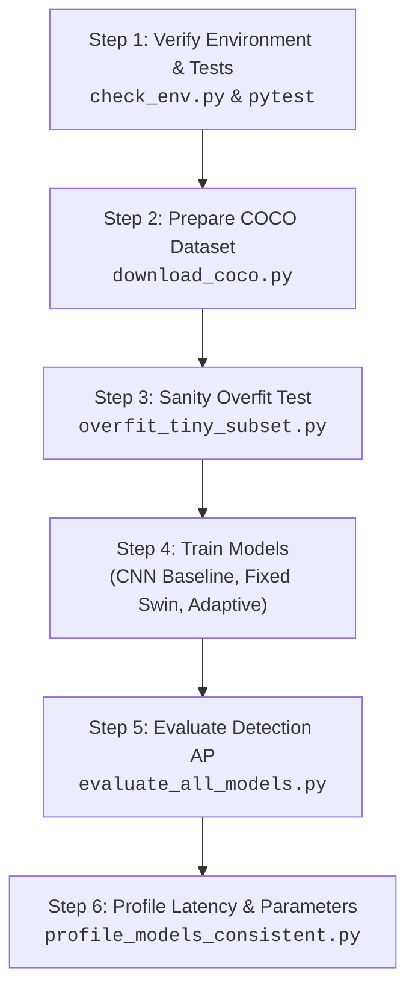

# Adaptive Allocation of Local and Global Representations for Efficient Object Detection

[](https://www.python.org/downloads/)
[](https://pytorch.org/)
[](LICENSE)

Official PyTorch implementation of the research paper:
> **Adaptive Allocation of Local and Global Representations for Efficient Object Detection**  
> *Mayukh Khan, Srikanta Pal*

---

## 📌 Overview

This framework investigates dynamic spatial routing between local convolutional representations and global Transformer attention modules for multi-scale object detection on **COCO 2017**.

- **Backbone**: Hierarchical ConvNeXt-Tiny extracting multi-scale feature maps at strides 8 ($P_3$), 16 ($P_4$), and 32 ($P_5$).
- **Contextual Adapters**: Shifted-window Swin Transformer adapters applied at $P_3$ and $P_4$.
- **Spatial Allocator**: Gumbel-Softmax routing module dynamically selecting between CNN-only, lightweight Swin, and deeper Swin feature paths.
- **Detection Head**: Shared RetinaNet-style classification and bounding-box regression towers with focal loss.

```
Input Image (640x640)
       │
 ConvNeXt-Tiny Backbone
   ├── P3 ──> Spatial Allocator (CNN vs Light Swin vs Deep Swin) ──> P3*
   ├── P4 ──> Spatial Allocator (CNN vs Light Swin vs Deep Swin) ──> P4*
   └── P5 ──> Direct Feature Propagation ───────────────────────────> P5
                                                                      │
                                                           Shared Detection Head
                                                      (Classification & Box Regression)
```

---

## 📁 Repository Structure

```text
├── configs/                       # Experiment YAML configurations
│   ├── cnn_baseline.yaml          # CNN-only ConvNeXt-Tiny baseline
│   ├── fixed_hybrid_p4.yaml       # Fixed Swin Transformer on P4 only
│   ├── fixed_hybrid_p3p4.yaml     # Fixed Swin Transformer on P3 and P4
│   └── adaptive_hybrid.yaml       # Spatial adaptive routing on P3 and P4
├── src/                           # Core source modules
│   ├── backbone/                  # ConvNeXt feature extractor
│   ├── transformer/               # Swin Transformer adapter blocks
│   ├── routing/                   # Gumbel-Softmax spatial allocator
│   ├── models/                    # Model definitions (CNN, Fixed, Adaptive)
│   ├── losses/                    # RetinaNet focal loss & budget loss
│   └── data/                      # COCO dataset loader & category mappings
├── scripts/                       # Training, evaluation & profiling pipelines
│   ├── check_env.py               # Environment & CUDA verification
│   ├── download_coco.py           # COCO 2017 download & extractor
│   ├── overfit_tiny_subset.py     # 8-image sanity / overfit test
│   ├── train_cnn_baseline.py      # Train CNN baseline
│   ├── train_fixed_hybrid.py      # Train fixed hybrid (P4 or P3P4)
│   ├── train_adaptive.py          # Train adaptive spatial routing model
│   ├── evaluate_all_models.py     # COCO 2017 val standard evaluation
│   └── profile_models_consistent.py # Synchronized latency & parameter benchmark
├── tests/                         # Unit tests (loss, transforms, category mapping)
├── checkpoints/                   # Model weight checkpoints (.pth)
├── results/                       # Metrics, profiles, and summary tables
├── requirements.txt               # Python package dependencies
└── DOCUMENTATION.md               # Continuous prompt and activity log
```

---

## ⚙️ Prerequisites & Environment Setup

### 1. Requirements
- **OS**: Windows or Linux
- **Python**: 3.10 or 3.11
- **Hardware**: NVIDIA GPU with CUDA support (e.g., RTX 3050 Laptop / RTX 3060 or higher)

### 2. Create and Activate Virtual Environment
```bash
# Windows (PowerShell)
python -m venv venv
.\venv\Scripts\Activate.ps1

# Linux / macOS
python3 -m venv venv
source venv/bin/activate
```

### 3. Install Dependencies
```bash
pip install --upgrade pip
pip install -r requirements.txt
```

---

## 🚀 Execution Workflow (Step-by-Step)

To reproduce the study or train/evaluate models, **run the scripts in the following exact order**:



---

### Step 1: Environment & Unit Verification

Run environment diagnostics and the test suite to ensure PyTorch, CUDA, and data mappings are verified.

```bash
# Check GPU, CUDA version, and timm installation
python scripts/check_env.py

# Run all unit tests (13 tests verifying category mapping, transforms, focal loss)
python -m pytest tests/ -v
```
*Expected: All 13 tests pass.*

---

### Step 2: Download & Prepare COCO 2017 Dataset

Run the automated download script (includes auto-resume and extraction):

```bash
python scripts/download_coco.py
```

Expected directory structure under `datasets/`:
```text
datasets/coco/
├── annotations/
│   ├── instances_train2017.json
│   └── instances_val2017.json
├── train2017/    # 118,287 images
└── val2017/      # 5,000 images
```

---

### Step 3: Fast Sanity Overfit Test (Recommended)

Before starting a multi-hour training run, verify that the loss drops and the model learns on a tiny 8-image subset:

```bash
python scripts/overfit_tiny_subset.py
```
*This runs 40 fast epochs and checks loss convergence and pycocotools COCOeval.*

---

### Step 4: Model Training

Train the four experimental models. Checkpoints are automatically saved in `checkpoints/<model_name>/final_model.pth`.

#### 1. CNN-only Baseline
```bash
python scripts/train_cnn_baseline.py --config configs/cnn_baseline.yaml
```

#### 2. Fixed CNN-Swin (P4 only)
```bash
python scripts/train_fixed_hybrid.py --variant P4
```

#### 3. Fixed CNN-Swin (P3 and P4)
```bash
python scripts/train_fixed_hybrid.py --variant P3P4
```

#### 4. Spatially Adaptive Routing (P3 and P4)
```bash
python scripts/train_adaptive.py --config configs/adaptive_hybrid.yaml
```

> **Tip for Quick Debug / Smoke Runs:**  
> Add `--max_batches 50 --epochs 1` to any training command to run a quick smoke-test:
> ```bash
> python scripts/train_cnn_baseline.py --max_batches 50 --epochs 1
> ```

---

### Step 5: Evaluate Detection Performance (COCO val2017)

Run the unified evaluation script to evaluate all trained models on `COCO val2017` (5,000 images). This generates official pycocotools metrics: **AP, AP50, AP75, APs, APm, APl**.

```bash
python scripts/evaluate_all_models.py
```

- Results are saved to `results/all_eval_summary.json` and individual JSON files in `results/`.
- Individual evaluation scripts can also be run directly:
  ```bash
  python scripts/evaluate_cnn_baseline.py
  python scripts/evaluate_fixed_hybrid.py --variant P4
  python scripts/evaluate_fixed_hybrid.py --variant P3P4
  python scripts/evaluate_adaptive.py
  ```

---

### Step 6: Benchmark Model Parameters and Inference Latency

Measure parameter counts, peak GPU memory, latency, and FPS under standardized profiling conditions (50 warm-up runs, 200 timed iterations, `torch.cuda.synchronize()`):

```bash
python scripts/profile_models_consistent.py
```

- Results are printed to console and saved in `results/benchmark_profile_consistent.json`.

---

## 📊 Summary of Execution Commands

| Stage | Command | Purpose | Output / Artifact |
|---|---|---|---|
| **1. Diagnostics** | `python scripts/check_env.py` | Verify GPU/CUDA | `results/environment.txt` |
| **1. Tests** | `python -m pytest tests/` | Verify 13 unit tests | Console output (13 passed) |
| **2. Dataset** | `python scripts/download_coco.py` | Download COCO 2017 | `datasets/coco/` |
| **3. Sanity** | `python scripts/overfit_tiny_subset.py` | 8-image overfit test | `checkpoints/diagnostic_test/` |
| **4. Train CNN** | `python scripts/train_cnn_baseline.py` | Train CNN Baseline | `checkpoints/cnn_baseline/` |
| **4. Train P4** | `python scripts/train_fixed_hybrid.py --variant P4` | Train Fixed Swin P4 | `checkpoints/fixed_p4/` |
| **4. Train P3/P4** | `python scripts/train_fixed_hybrid.py --variant P3P4` | Train Fixed Swin P3/P4 | `checkpoints/fixed_p3p4/` |
| **4. Train Adaptive**| `python scripts/train_adaptive.py` | Train Adaptive Router | `checkpoints/adaptive/` |
| **5. Evaluate** | `python scripts/evaluate_all_models.py` | COCO 2017 validation | `results/all_eval_summary.json` |
| **6. Profile** | `python scripts/profile_models_consistent.py` | Latency, FPS, Params | `results/benchmark_profile_consistent.json` |

---

## 🛠️ Key Numerical Stability Features

This codebase includes crucial numerical stability and correctness guarantees:
1. **Focal Loss Prior Bias**: Classification towers are initialized with prior probability bias $b = -\log((1 - \pi) / \pi) = -4.595$ ($\pi = 0.01$). This eliminates gradient explosions on step 0 and stabilizes ConvNeXt-Tiny backbones.
2. **Bijective Category Mapping**: Implements canonical mapping between COCO non-contiguous IDs (1–90) and internal labels (0–79), preventing class collapse.
3. **Reproducibility**: Standardized seeds and logging across all scripts.

---

## 📝 Activity & Prompt Log

All activities, modifications, bug repairs, and test runs are tracked continuously in [`DOCUMENTATION.md`](DOCUMENTATION.md).
